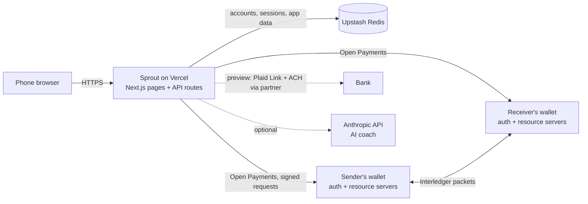
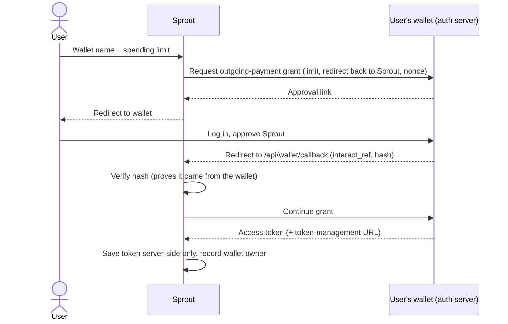

# Sprout — Technical Design

_Last updated: November 12, 2026 · Status: prototype on the Interledger test network_

## 1. Summary

Sprout is a money app for people starting from zero in the US (newcomers, students, anyone without an SSN or credit history). It combines a **wallet for sending and receiving money**, a **budget**, **practice investing** and **short lessons**.

All money movement runs over **Interledger's Open Payments** standard. Sprout never holds anyone's money: a licensed wallet provider does, and Sprout acts on the person's behalf only within a spending limit they approved.

**One line for Demo Day:** *Users see a simple Sprout account — pay by @username, link a bank to add money. Underneath, every payment runs over Interledger's Open Payments, so Sprout works with any compatible wallet worldwide and never holds anyone's money itself.*

## 2. Product direction: "Option B"

There are two ways a real Sprout can give people a wallet:

| | Option A: bring your own wallet | **Option B: Sprout opens one for you (target)** |
|---|---|---|
| Sign-up | User must already have an Open Payments wallet and connect it | Sprout's licensed wallet partner opens a wallet during Sprout sign-up, with identity checks (KYC) built in |
| What the user sees | Wallet addresses, approval screens from another company | Just "your Sprout account" |
| Adding money | In the other wallet's app | **Link a bank (Plaid) → Add money** inside Sprout |
| Who holds money | The user's wallet provider | Sprout's wallet partner (licensed) |

**We target Option B.** The demo runs Option A against the test network, because a partner wallet and Plaid aren't available for a class project. The screens are already shaped like Option B so the story is clear:

- **Real today:** sign-up and login, connecting a wallet with a spending limit, sending and receiving real (test-network) payments, payment requests, reading wallet activity, names on payments, the budget.
- **Preview (simulated, labelled in the app):** linking a bank, Add money and Cash out between the bank and the wallet.

## 3. Architecture

| Piece | Choice | Notes |
|---|---|---|
| App | Next.js 16 (React 19), TypeScript | Pages and server API routes in one project |
| Hosting | Vercel | Serverless functions; no shared disk between instances |
| Database | Upstash Redis (key-value) | Locally falls back to JSON files in `.data/kv` |
| Payments | `@interledger/open-payments` SDK | Interledger test network (`ilp.interledger-test.dev`) |
| AI coach | Anthropic API (optional) | Off ("mock") unless `AI_MODE=live` |
| Market data | Snapshot or Finnhub | For practice investing only |

### Key code locations

| Area | Files |
|---|---|
| Open Payments calls | `src/lib/server/payments/interledger.ts` |
| Payment rules (quotes, signing, idempotency) | `src/lib/server/payments/index.ts` |
| Wallet connect + callback | `src/app/api/wallet/connect`, `src/app/api/wallet/callback`, `src/lib/server/wallet-link.ts` |
| Send / request / receive | `src/app/api/payments/{quote,send,request,incoming}` |
| Wallet activity | `src/app/api/wallet/activity`, `src/components/money/wallet-activity.tsx` |
| Accounts and sessions | `src/lib/server/auth.ts`, `src/lib/server/users.ts`, `src/app/api/auth/*` |
| Storage | `src/lib/server/db.ts`, `src/lib/server/kv.ts` |
| Bank preview | `src/app/api/bank`, `src/components/money/bank-transfer.tsx` |
| Budget expenses | `src/app/api/transactions` |

## 4. How Interledger fits

- **Interledger (ILP)** routes a payment between different ledgers (wallet providers), converting currency along the way if needed — like internet protocols routing data between networks.
- **Open Payments** is the API apps use to act on a person's account at any compliant provider: create payment requests, get quotes and send payments.
- **GNAP grants** are how permission works. A wallet's auth server issues access tokens. Some grants need no user approval (creating an incoming payment, getting a quote). Sending money always needs the owner's interactive approval, with a spending limit.
- **Sprout's identity:** Sprout signs every request with its own key pair. The public key is published on Sprout's client wallet address (`OP_CLIENT_WALLET_ADDRESS`, key ID `OP_KEY_ID`). This key identifies the app; it can't move anyone's money on its own.

## 5. Main flows

### 5.1 Connect a wallet (one time)

- The approval also proves the person owns the wallet.
- Tokens are stored apart from the user's data and are never sent to the browser.
- Disconnecting cancels the grant at the wallet.

### 5.2 Send money

1. **Find the person:** by @username (a Sprout member), wallet name (`ilp.interledger-test.dev/` filled in), full address or QR.
2. **Quote** (`POST /api/payments/quote`):
   - Look up both wallets (currency, servers).
   - Get a grant from the receiver's wallet and create an **incoming payment** there, with the memo *"From Ana López (@ana)"*.
   - Get a grant from the sender's wallet and create a **quote** (exact amount sent and received, including fees or currency conversion).
   - Sprout signs the quote (HMAC) so the browser can't change it, valid for 5 minutes.
3. **Review:** the user sees amount, fee, what they'll receive and a test-money notice.
4. **Send** (`POST /api/payments/send`):
   - Verify the signature and expiry.
   - Create the **outgoing payment** with the user's approved token, memo *"To Maya Torres (@maya) · note"*. If the token expired, rotate it once and retry.
   - An **idempotency key** makes double taps and retries return the same payment, never a second one.
   - Record the transfer and add it to the budget.
5. The sender's wallet streams Interledger packets to the receiver's incoming payment until it's filled.

### 5.3 Receive money and payment requests

- **Request:** Sprout creates an incoming payment on the user's own wallet for a set amount and gives them a link or QR to share.
- **Receiving:** Sprout lists incoming payments on the user's wallet. New money is credited once (a claim record stops the same payment being counted by two accounts).
- **Who sent it:** Sprout members' payments carry *"From name (@handle)"*. Wallets don't reveal the sender otherwise, so outside payments show as "Payment received".

### 5.4 Wallet activity (Home)

- Read live from the wallet: incoming payments plus outgoing payments (using the user's token).
- Names come from Sprout's own records first, then the payment memo.
- **No balance:** Open Payments has no balance API, so Home shows Received and Sent totals and links to the wallet for the balance. With Option B, the partner's own API would provide the balance.

### 5.5 Names on payments

Sprout keeps a **wallet → member** lookup (`wallet-owner:<url>`), set when a wallet is connected, a payment is sent or Home loads. Paying a member's wallet shows their profile name and @username, not the wallet's public name (often the same for every wallet on one test account).

### 5.6 Budget

- **Automatic:** every payment sent or received through Sprout is added to transactions.
- **Manual:** *Add an expense* for cash, card or anything outside the wallet. Manual entries can be deleted.
- Option B + Plaid later: card and bank transactions could be imported automatically.

### 5.7 Bank link, Add money, Cash out (preview)

- **Today:** pick a demo bank (simulated Plaid Link), then add money or cash out. The transfer is recorded as "Simulated"; no money moves. Add money explains how to top up the test wallet for the demo.
- **Production plan:**
  1. Plaid Link connects the user's bank; Sprout never sees bank login details.
  2. Plaid returns an account token, which goes to the wallet partner.
  3. The partner pulls money by ACH into the user's wallet (1–3 business days), or pushes it back to the bank on cash out.
  4. Sprout shows the status from the partner's webhooks.

## 6. Data and storage

Upstash Redis, one JSON value per key:

| Key | Holds |
|---|---|
| `account:<email>` | User ID, password hash, created and terms-accepted dates |
| `user:<id>` | Profile, settings, budget, bills, transactions, transfers, requests, bank preview |
| `session:<token hash>` | Session for a sign-in (30 days) |
| `handle:<username>` | Which user owns an @username |
| `wallet-link:<id>` | Connected wallet and its access token (server-only) |
| `wallet-connect:<state>` | In-progress approval (15 minutes, used once) |
| `wallet-owner:<url>` | Which member uses a wallet |
| `sprout:claim:<payment>` | Which account a received payment was credited to |
| Rate-limit counters | Sign-up, login, username lookup |

## 7. Security

- **Passwords:** scrypt with a per-user salt; never stored or logged in plain text.
- **Sessions:** random token in an httpOnly, SameSite cookie; only its hash is stored; 30-day expiry.
- **Writes:** same-origin check on every change; rate limits on sign-up, login, account deletion and username lookup.
- **Headers:** Content-Security-Policy, X-Frame-Options DENY, HSTS in production, no caching of API responses.
- **Payments:**
  - Signed quotes.
  - Idempotent sends.
  - Tokens server-side only.
  - Approval hash verified on connect.
  - Live sends never fall back to a fake success.
  - Wallet addresses must be public `https` domains (no IPs or internal hosts).
- **Secrets:** only in environment variables (`.env` locally, Vercel settings in production); none in git.

## 8. Compliance

| Area | Today | Before real money |
|---|---|---|
| Holding money | Sprout holds none; test money only | Wallet partner holds funds under its license; confirm with a fintech lawyer |
| Identity (KYC/AML, sanctions) | Not needed for test money | Done by the wallet partner during sign-up |
| Consent | 18+ checkbox, Terms and Privacy, recorded with date and version | Same, updated for real money |
| Disclosures | "Test network, play money, not a bank, not FDIC insured" on review | Partner disclosures, fees, limits |
| Disputes and errors | — | Process for errors and disputes on electronic transfers (Reg E) with the partner |
| Privacy | No tracking or ads; account deletion | Same, plus data-processing terms with Plaid and the partner |
| Investing | Practice only, no advice, AI coach blocked from promising returns | Same, unless real investing is added |

## 9. Configuration (Vercel environment variables)

| Variable | Purpose |
|---|---|
| `KV_REST_API_URL`, `KV_REST_API_TOKEN` | Upstash Redis |
| `SESSION_SECRET` | Signs payment quotes |
| `APP_URL` | Public URL wallets send people back to |
| `PAYMENTS_MODE` | `interledger` for live test-network payments, `mock` for simulated |
| `OP_CLIENT_WALLET_ADDRESS`, `OP_KEY_ID`, `OP_PRIVATE_KEY` | Sprout's Open Payments identity |
| `AI_MODE`, `ANTHROPIC_API_KEY` | Optional AI coach |
| `MARKET_MODE`, `FINNHUB_API_KEY` | Optional live market data |

## 10. Known limits

- Test network only: no real money.
- No balance number (Open Payments has no balance API).
- Wallets on the test network are created by hand; Option B would create them automatically.
- Payments from outside Sprout don't show who sent them.
- Bank link, Add money and Cash out are simulated.
- The `ilp.interledger-test.dev/` prefix is built in; real use needs several wallet providers.
- Sprout's client key belongs to a personal test wallet; production needs a dedicated Sprout key.

## 11. Roadmap

1. **Now (Demo Day):** live wallet-to-wallet payments, requests, names, activity, budget, bank preview.
2. **Next:**
   - QR and "pay me" links.
   - Pay by phone or email with claim links.
   - A dedicated Sprout client key.
3. **Option B pilot:**
   - Partner with a licensed Open Payments wallet provider.
   - Create wallets at sign-up with their identity check.
   - Plaid Link for bank connections, plus partner ACH for Add money and Cash out.
   - Real balances from the partner's API.
4. **Later:**
   - Cross-border sends to family wallets in other currencies.
   - Recurring bill payments within approved limits.
   - Importing card and bank transactions into the budget.

## 12. Demo script (about 2 minutes)

1. Sign up (18+ consent), set up a profile and connect a test wallet with a $50 limit.
2. Home: wallet activity is live from the wallet; tap a payment for details.
3. Send $1 to a classmate by @username, then show the review, fee and test-money notice.
4. Switch to the classmate: the payment shows *"From your name (@you)"*.
5. Request money: share the link or QR.
6. Budget: the payment is already there; add a cash expense.
7. Add money: link a demo bank (preview), then explain the Plaid + partner plan.
8. Close with the one-liner from section 1.
